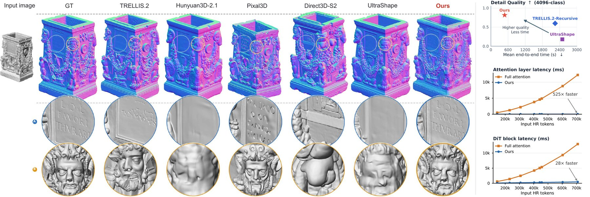
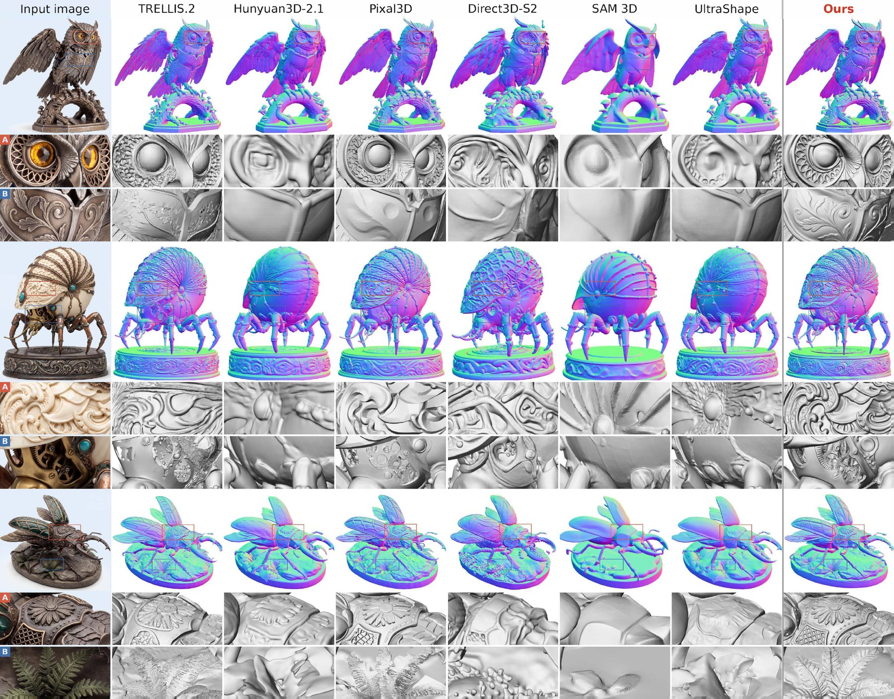
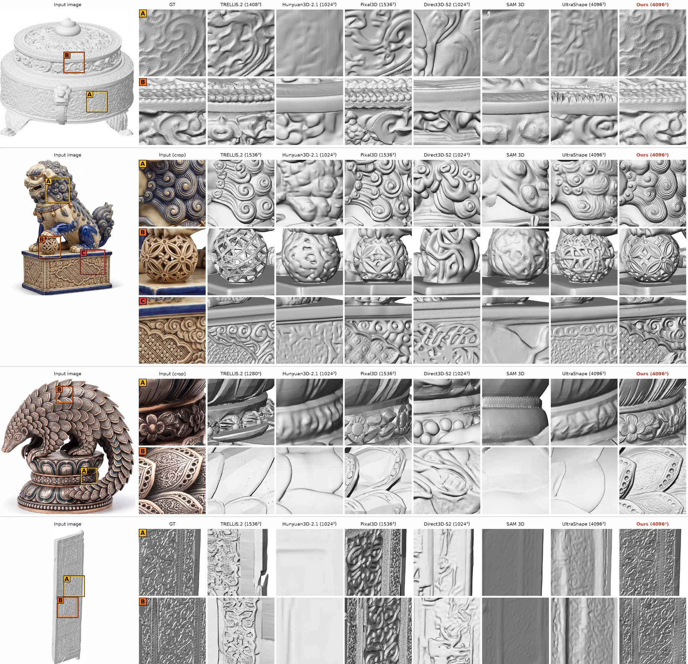
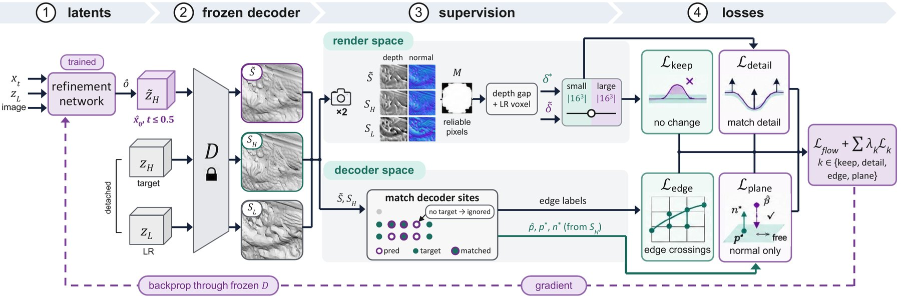

<div align="center">

# SuperFine3D

### Efficient Global-Local Recursive Refinement for Extremely Detailed 3D Geometry Generation

<a href="https://lihhan.github.io/SuperFine3D-page/"></a>


**A single image &rarr; 4096³ geometry in about three minutes on one GPU.**

</div>

<p align="center"></p>

<p align="center"><sub><b>High-resolution geometry with fine detail and efficient inference.</b> Surface normals of GT, TRELLIS.2,
Hunyuan3D-2.1, Pixal3D, Direct3D-S2, UltraShape and ours, with zooms A and B; detail quality vs. end-to-end time; latency of
one attention layer and one DiT block vs. high-resolution tokens.</sub></p>

| <h3>4096³</h3>decoder grid (sparse 256³ latent) | <h3>9.4&times;</h3>faster than full-attention recursion, 23.0% less memory | <h3>525&times;</h3>faster attention layer at 708k tokens | <h3>28&times;</h3>faster DiT block at 708k tokens |
|:---:|:---:|:---:|:---:|

## Overview

SuperFine3D learns a **shared refinement operator** from paired coarse-to-fine representations and **recursively reuses it**
to synthesize geometry beyond the training resolutions: trained only on 512³/1024³ TRELLIS.2 latents, it refines
1024³ &rarr; 2048³ &rarr; 4096³, a sparse 256³ latent lattice.

<p align="center"></p>

<p align="center"><sub><b>Overview.</b> A pretrained generator produces a coarse 512³ shape, from which the input camera is
estimated. At every level, detail normals estimated from the input image are injected into the current mesh; the corrected
mesh is encoded at twice the resolution, partially noised, and refined by the shared refinement network conditioned on the
preceding latent and the image (bottom).</sub></p>

<p align="center"></p>

<p align="center"><sub><b>Recursive refinement, level by level.</b> Generation beyond training resolutions: the same operator, trained on 512³–1024³ pairs, refines
1024³ &rarr; 2048³ &rarr; 4096³.</sub></p>

- **Spatial-cell attention** restricts high-resolution interactions to local spatial neighborhoods while keeping bounded,
  boundary-prioritized communication across neighboring cells. All cells run in one indexed launch of a FlashAttention-2 varlen
  kernel with fused 3D RoPE (`third_party/flash_attn_3d_rope_fa2`).
- **Spatially anchored cross-scale guidance** uses globally contextualized coarse geometry to guide local detail synthesis
  and preserve structural consistency.
- **Geometry-aware training objectives** keep stable structures unchanged and introduce fine-grained surface detail.
- **Image-faithful detail:** a fine-tuned one-step diffusion normal estimator, run on tiles of the upsampled input, drives a
  band-limited height field; a mesh-conditioned variant keeps albedo out of the geometry.

## Results

<p align="center"></p>

<p align="center"><sub><b>Comparison of fine geometric details.</b> Inputs are 4096 px images generated with Nano Banana Pro,
identical for all methods.</sub></p>

End-to-end inference at 4096³-class resolution on the same input (paper Table 2):

| Method | Time (s) ↓ | Peak memory (GiB) ↓ |
|---|---|---|
| TRELLIS.2-Rec. (full attention) | 1654.14 | 63.07 |
| UltraShape | 2214.71 | – |
| **SuperFine3D** | **176.19** | **48.54** |

SuperFine3D is 9.4&times; faster than TRELLIS.2-Rec. with 23.0% less peak GPU memory, and about 12.6&times; faster than
UltraShape.

<details>
<summary><b>More results</b> (off-view detail, textured inputs, input resolution, two views, ablations)</summary>

<p align="center"><br>
<sub><b>Additional comparisons</b>: carved censer, guardian lion and pangolin (generated images), and ornate wooden door.</sub></p>

<p align="center"><br>
<sub><b>Detail holds off the input view</b>: close-ups rendered with the object turned by 30&deg;.</sub></p>

<p align="center"><br>
<sub><b>Image appearance is not carved into the surface</b>: carved feathers, chased medallions and carved scales are recovered;
grain stripes and painted checks do not become relief.</sub></p>

<p align="center"><br>
<sub><b>Novel-view comparison</b>: a single view stretches the dragon sideways; two views recover its pose.
Photos: The Cleveland Museum of Art, Open Access (CC0).</sub></p>

<p align="center"><br>
<sub><b>Training objective</b>: L<sub>keep</sub>, L<sub>detail</sub> (render space) and L<sub>edge</sub>, L<sub>plane</sub>
(decoder space) are added to the flow-matching loss.</sub></p>

</details>

The [project page](https://lihhan.github.io/SuperFine3D-page/) (`docs/`) has an interactive 3D viewer: SuperFine3D side by
side with each baseline under one camera, click-to-zoom, and hotspots that load full-resolution geometry; plus the
project video.

## Repository layout

| Path | Contents |
|---|---|
| `scripts/infer.sh` | image → mesh |
| `scripts/infer_dual.sh`, `superfine3d/dual/` | two photos → mesh (the paper's two-view figure) |
| `assets/examples/` | 4096² RGBA example inputs (pangolin, nautilus); `dual/`: the two photos of the two-view figure |
| `superfine3d/detail/bench/pipeline_body.py` | the end-to-end pipeline (stage list in its header) |
| `superfine3d/refiner/code/` | refiner model (`ablation_model.py`, `structure.py`, stage packages `tf3`–`tf8`), spatial-cell attention session (`session.py`, `kernel_session.py`, `tf6_2/boundary_attention.py`), LR guidance (`custom_attention/lr_guidance.py`) |
| `superfine3d/refiner/generate.py` | refinement driver (support construction, SDEdit sampling per level) |
| `superfine3d/refiner/decode_code/` | low-memory decoding of 2048³/4096³ latents |
| `superfine3d/detail/bench/ours_fast.py`, `ours_triton.py` | fused DiT kernels: LoRA merged into QKV/out, Triton RMSNorm+RoPE, LayerNorm+adaLN, indexed LR reads |
| `third_party/flash_attn_3d_rope_fa2/` | FlashAttention-2 varlen fork with fused 3D RoPE and row-indexed K/V |
| `superfine3d/detail/hfdetail/`, `superfine3d/detail/whole/inject_lib.py` | detail estimation on tiles, band-limited targets, height-field optimisation, hole capping |
| `superfine3d/detail/fit_input_camera.py`, `superfine3d/detail/whole/camera_refine.py` | input-camera fit (silhouette) and appearance refinement |
| `superfine3d/detail/fig5/pixal512_worker.py`, `superfine3d/start/cand_start.py` | Pixal3D 512³ start and its placement in the input frame |
| `superfine3d/encode/pairs.py`, `superfine3d/detail/hfdetail/latent_io.py`, `parvox.py` | mesh → latent encoding (parallel voxelisation) |
| `training/refiner/` | the five refiner training stages (`run_stage.sh`, `configs/`), training data build (`build_data.sh`) and asset lists (`data/`) |
| `training/estimator/` | detail-estimator fine-tuning (`train.sh`, `ft_train.py`), training data build (`build_data.sh`, `build_v2.sh`) and asset / crop lists (`data/`) |
| `evaluation/` | CD-L1 / F-score / DQ (`score_geometry.py`) and image-space normal fidelity (`fid_t4k_img.py`) |
| `setup/` | environment (`env.sh`), CUDA extension and kernel builds, TRELLIS.2 fork preparation, config rendering |

## Installation

Tested with Python 3.10, CUDA 12.8 and PyTorch 2.9.0 on RTX PRO 6000 Blackwell GPUs (sm_120, 96 GB).

1. **Python environment** (a fresh Python 3.10 venv or conda env)
   ```bash
   python -m pip install -U pip        # an old pip (e.g. 23.0) rejects some wheels' metadata
   pip install torch==2.9.0 torchvision==0.24.0 --index-url https://download.pytorch.org/whl/cu128
   pip install -r requirements.txt
   ```
2. **TRELLIS.2** at commit `75fbf01` and its CUDA extensions (`nvdiffrast` v0.4.0, `CuMesh`, `FlexGEMM`, `o-voxel`,
   `flash-attn==2.7.3`). The extensions are built as wheels into `third_party/site-packages`, which comes first on the
   path of SuperFine3D and of the Pixal3D worker, so both environments share them.
   ```bash
   git clone https://github.com/microsoft/TRELLIS.2.git third_party/TRELLIS.2
   git -C third_party/TRELLIS.2 checkout 75fbf01
   bash setup/build_extensions.sh      # sources in .cache/ext_src (pinned revisions), wheels -> third_party/site-packages
   ```
   Build notes (also for step 3):
   - CUDA 12.8's `nvcc` accepts host compilers up to gcc 14. With a newer system gcc, point `CC`, `CXX` and
     `CUDAHOSTCXX` to a gcc &le; 14 (e.g. conda's `gxx_linux-64=14`).
   - The extensions include cuSPARSE / cuBLAS headers through PyTorch. If your CUDA toolkit does not ship them, use the
     headers of PyTorch's `nvidia-*` wheels:
     `export CPATH=$(python -c "import nvidia, glob, os; print(':'.join(glob.glob(os.path.join(nvidia.__path__[0], '*', 'include'))))")`
   - The default target is sm_120; set `TORCH_CUDA_ARCH_LIST` / `FLASH_ATTN_CUDA_ARCHS` for other GPUs.
   - `setup/flex_autotune.json` holds the FlexGEMM kernel choices of our runs (RTX PRO 6000 Blackwell). `setup/env.sh`
     copies it into `.cache/` on first use, so on that GPU the 512³ start and the camera fit match ours exactly; other GPUs
     autotune on their first run (slower first run).
3. **Our attention kernel**
   ```bash
   bash setup/build_kernels.sh
   ```
4. **Pixal3D** (512³ start; only needed for the default `pixal3d` start): clone [TencentARC/Pixal3D](https://github.com/TencentARC/Pixal3D) at commit `f7cf384`
   into `third_party/Pixal3D/repo`. Install its Python requirements in its own Python 3.10 virtual environment
   (`third_party/Pixal3D/venv`) following its README; its CUDA extensions come from `third_party/site-packages` (step 2).
   Put its weights in `third_party/Pixal3D/weights`.
   - **Two-view input** (only for `scripts/infer_dual.sh`):
     - Pixal3D's two multi-view checkpoints `ckpts/ss_flow_img_dit_1_3B_64_bf16_mv.safetensors` and
       `ckpts/slat_flow_img2shape_dit_1_3B_512_bf16_mv.safetensors` (TencentARC/Pixal3D on Hugging Face) in the same weights folder.
     - [MASt3R](https://github.com/naver/mast3r) at commit `f5209af`, with its submodules, in `third_party/mast3r`;
       `pip install roma scikit-learn` in the Pixal3D environment; the `naver/MASt3R_ViTLarge_BaseDecoder_512_catmlpdpt_metric`
       weights in the Pixal3D Hugging Face cache (or `SF3D_MAST3R_HF_CACHE`).
5. **Detail estimator code and base weights**
   - Clone [hugoycj/StableNormal](https://github.com/hugoycj/StableNormal) at commit `1b7203c` into `third_party/StableNormal`
     (its YOSO pipeline differs from the Stable-X/StableNormal head):
     ```bash
     git clone https://github.com/hugoycj/StableNormal.git third_party/StableNormal
     git -C third_party/StableNormal checkout 1b7203c
     ```
   - Download `Stable-X/yoso-normal-v1-8-1` (NiRNE) and point `SF3D_NIRNE_WEIGHTS` to it.
6. **TRELLIS.2-4B weights**
   - Download `microsoft/TRELLIS.2-4B` and point `SF3D_TRELLIS2_WEIGHTS` to the snapshot.
   - The image condition model `facebook/dinov3-vitl16-pretrain-lvd1689m` must be in the Hugging Face cache
     (`HF_HOME`). It is a gated model, so accept its license on Hugging Face first.
7. **SuperFine3D weights**
   ```
   checkpoints/refiner/denoiser_step0002000.pt   (116 MB; trainable refiner parameters; train.json is in the repository)
   checkpoints/estimator/grey/ckpt_04000.pt      (2.3 GB; detail estimator, grey route)
   checkpoints/estimator/rgb/ckpt_last.pt        (2.3 GB; mesh-conditioned detail estimator, textured inputs)
   ```
   Download them from [Google Drive](https://drive.google.com/drive/folders/1I2KeboWe3f-i4HSIXzOqh1bS0qYn3INC?usp=drive_link)
   (4.7 GB), check them and copy them into `checkpoints/` (the default `SF3D_CKPT`):
   ```bash
   pip install gdown
   gdown --folder https://drive.google.com/drive/folders/1I2KeboWe3f-i4HSIXzOqh1bS0qYn3INC -O SuperFine3D_weights
   (cd SuperFine3D_weights && sha256sum -c SHA256SUMS)      # three lines ending in OK
   cp -r SuperFine3D_weights/checkpoints/. checkpoints/
   ```
   If gdown stops at Google Drive's download limit, download the folder in a browser instead and run the same check.
8. **Locations:** edit the variables marked `set me` in `setup/env.sh`. Every script reads its locations from there.
9. **Estimator build** (optional, recommended): `bash setup/build_estimator_aot.sh` compiles the detail-estimator networks
   that the pipeline re-runs at every level (AOTInductor; 3–4 minutes, once per GPU and PyTorch version; each
   network is checked against the eager one). Without it the same settings run with the eager networks.

## Inference

```bash
# Pixal3D 512^3 start -> outputs/pangolin/final_4096.ply
bash scripts/infer.sh assets/examples/pangolin.png outputs/pangolin
# 2048^3 output
bash scripts/infer.sh assets/examples/pangolin.png outputs/pangolin_2048 2048
# TRELLIS.2 512^3 start
bash scripts/infer.sh assets/examples/nautilus.png outputs/nautilus 4096 trellis2
```

`assets/examples/` holds the two 4096&times;4096 inputs of the project page's 3D viewer (AI-generated images).
An input must be an RGBA image whose alpha channel masks the object. Background removal is not run.

**512³ start.** Set the fourth argument, or `SF3D_START`:

| `START` | 512³ start | Notes |
|---|---|---|
| `pixal3d` (default) | Pixal3D native 512³ output | Placed in the TRELLIS.2 reference frame and re-fitted to the input image. Runs concurrently with the reference frame. |
| `trellis2` | the TRELLIS.2 512³ shape of the reference frame, with its fitted camera | Pixal3D is not run and does not need to be installed. |

Everything after the start is identical for both: detail injection, encodes, recursive refinement, decoding and export.

### Two photos

```bash
E=assets/examples/dual
bash scripts/infer_dual.sh $E/saint_george_view0.jpg:$E/saint_george_view0_mask.png \
                           $E/saint_george_view1.jpg:$E/saint_george_view1_mask.png outputs/saint_george 18017
```

- **Inputs:** two photos of one object from the same camera and lens, each as an RGBA image or `PHOTO:MASK`. View 0 gives
  the surface detail; view 1 constrains the shape. The fourth argument is the focal length in pixels (from EXIF:
  focal_mm / sensor_width_mm × image width); without it the MASt3R pointmap focal of the pair is used.
- **Steps:** single-view Pixal3D on view 0 (defines the world) → PnP of view 0 → MASt3R matches → views rectified with
  the true focal, relative pose from the essential matrix → Pixal3D multi-view 512³ start → the exact camera of view 0
  in that world → `scripts/infer.sh` with this start (`SF3D_START=given`). Intermediate files are in `OUT/dual/`.
- **Example:** the photos of the paper's two-view figure (Cleveland Museum of Art, *Saint George and the Dragon*,
  1959.341, CC0). The command above reproduces the paper's mesh: every intermediate file up to the start is identical,
  and the final silhouette IoU at the two input photos and the two held-out photos (0.935 / 0.924 / 0.639 / 0.813)
  matches the paper's.
- **`report.json`** records the time and peak GPU memory of every stage.
- **Stages:**
  1. TRELLIS.2 reference frame and input camera.
  2. 512³ start: Pixal3D, run concurrently and placed in the input frame (`pixal3d`), or the reference frame itself
     (`trellis2`).
  3. Detail injection at 512³ and 1024³.
  4. Encode 2048³ → refine → decode.
  5. Inject → encode 4096³ → refine → decode.
  6. Final band-limited injection and hole capping.
- **Exactness:** the `OPT_*` speed switches set by `scripts/infer.sh` give the same output as the reference path.
  `FUSED=0` falls back to the unfused DiT. The estimator acceleration (cuDNN autotuning, AOTInductor
  networks) changes the estimate only at fp16 rounding level.

## Training

### Refiner

1. **Data.** The refiner is trained on the 10,000 Objaverse-XL (Sketchfab) assets listed in
   `training/refiner/data/train_10000.txt`; stage 2 uses the 9,900 of `train_9900.txt`. Their TRELLIS.2 latents and
   condition views are built with TRELLIS.2's `data_toolkit`: download → mesh dump → dual grids → shape latents at
   256³/512³/1024³ → one condition view per asset (`SF3D_COND_VIEWS` for more).
   ```bash
   source setup/env.sh
   bash setup/prepare_trellis2_variants.sh        # TRELLIS.2 fork used by the data toolkit and the trainers
   bash training/refiner/build_data.sh            # -> $SF3D_DATA; optional RANK WORLD_SIZE to split the assets
   python setup/convert_trellis2_denoiser.py      # TRELLIS.2 1024 flow model -> checkpoints/trellis2/official_1024_denoiser.pt
   ```
   - The script lays out `$SF3D_DATA` as the configs read it: `shape_latent_1024/`, `shape_latent_512/`, `renders_cond/`,
     `data256/` and `metadata/`. The toolkit's working tree is `$SF3D_DATA/objaverse_sketchfab`.
   - The toolkit downloads Blender itself; the script puts it in `$SF3D_BLENDER_DIR` (default `.cache/blender`) instead of `/tmp`.
   - The lists contain asset IDs only; the assets are downloaded from Objaverse under their own licenses.
2. **Stages.** Each stage starts from the previous one:

   | Stage | Trains | Steps |
   |---|---|---|
   | 1 | spatial-cell attention (HR LoRA, boundary-prioritized cross-cell routing), from the TRELLIS.2 1024 flow model | 5000 |
   | 2 | cross-scale guidance (LR adapters reading the 512³ parent latent) | 3000 |
   | 3 | joint HR/LR fine-tuning | 3000 |
   | 4 | refinement objective on decoded geometry (keep / detail) | 3000 |
   | 5 | geometry objective (edge / plane terms): the released refiner | 2000 |

   ```bash
   for s in 1 2 3 4 5; do bash training/refiner/run_stage.sh $s; done
   ```
   - Each stage writes to `runs/stageN_*` and links its checkpoints into `checkpoints/stages/`.
   - Stage 5 also links the final weights to `checkpoints/refiner/`.
   - Configuration overrides go after the stage number, for example `trainer.args.max_steps=10`.
   - One GPU per stage (about 75 GB).

### Detail estimator

The estimator is NiRNE, initialised from `yoso-normal-v1-8-1`. It is fine-tuned to predict normals of zoomed-in crops
at the model's native 768 px tile size. The loss combines cosine error with a masked high-pass term.

```bash
bash training/estimator/train.sh grey     # grey-shaded crops                    -> checkpoints/estimator/grey
bash training/estimator/train.sh rgb      # textured, lit, mesh-conditioned      -> checkpoints/estimator/rgb
```

The RGB route proceeds in steps:
1. Start from the grey model.
2. Train on 50% textured and lit views.
3. Switch to mesh conditioning: the UNet starts from the latent of the coarse mesh normals, and the image drives the
   ControlNet.
4. Add v2 relief and scan crops, with conditioning misalignment and dropout plus albedo, photometric and exposure
   augmentation.

**Data** goes under `$SF3D_DATA/estimator`. The asset and crop lists are in `training/estimator/data`:
- `z1.json`: 492 Objaverse assets with 1,734 crops (crop centre and zoom factor 2 or 4).
- `train.json`: 18 densely scanned or sculpted assets with 332 crops.
- `v2/v2b0.json` … `v2b7.json`: 200 relief and scan assets. Their crops are drawn per asset with a fixed seed, and a
  detail filter keeps 1,365 views.

```bash
bash training/estimator/build_data.sh 0 1      # two GPUs; Blender 4.2 (SF3D_BLENDER); after setup/prepare_trellis2_variants.sh
```

Every crop goes through: GLB download → Blender mesh dump → crop latent → grey view at 1024 px → GT normal target →
coarse-normal condition (z1, train) → textured, lit views. `train.sh` trains the grey model on z1 and train and adds
v2 for the RGB model; 30 z1 assets and 12 v2 assets are held out for validation.

## Evaluation

```bash
source setup/env.sh
python evaluation/score_geometry.py KEY MESH.ply OUT.json      # CD-L1, P95, F-scores, DQ (MeshyBench quality_4096)
bash setup/python.sh evaluation/fid_t4k_img.py KEY OUT.json LABEL=MESH@CAMDIR [...]   # Ang. and band correlations
bash evaluation/cam_t4k.sh LIST                                # baseline cameras (image-only fit) + fidelity
```

- **Geometry:** each mesh is normalised and rigidly aligned to the ground truth (100k samples). CD-L1 and F-scores are
  then computed point-to-triangle with 2M samples per direction.
- **DQ** uses [MeshyBench](https://github.com/meshy-dev/meshybench) at commit `5cce370`; point `SF3D_MESHYBENCH` to that
  checkout (default `third_party/meshybench`).
- **Image-space fidelity:** each method is rendered with its own image-only fitted camera on the pixel grid of the
  input crop and compared with ground-truth normals. The 4–16 px and 16–64 px band correlations are normal-map
  correlations after band-pass filtering.

## Acknowledgements and licenses

SuperFine3D builds on [TRELLIS.2](https://github.com/microsoft/TRELLIS.2),
[Pixal3D](https://github.com/TencentARC/Pixal3D), [StableNormal / NiRNE](https://github.com/Stable-X/StableNormal),
[FlashAttention](https://github.com/Dao-AILab/flash-attention) and [MeshyBench](https://github.com/meshy-dev/meshybench).
See `THIRD_PARTY_NOTICES.md` for the files derived from them and their licenses.
The two-view pipeline also calls [MASt3R](https://github.com/naver/mast3r) (CC BY-NC-SA 4.0; not included, installed separately).
The two-view example photos are from the Cleveland Museum of Art Open Access collection (CC0).

## Citation

```bibtex
@misc{li2026superfine3d,
  title  = {SuperFine3D: Efficient Global-Local Recursive Refinement for Extremely Detailed 3D Geometry Generation},
  author = {Li, Lihan and Zhou, Junwei and Tai, Yu-Wing},
  year   = {2026}
}
```
